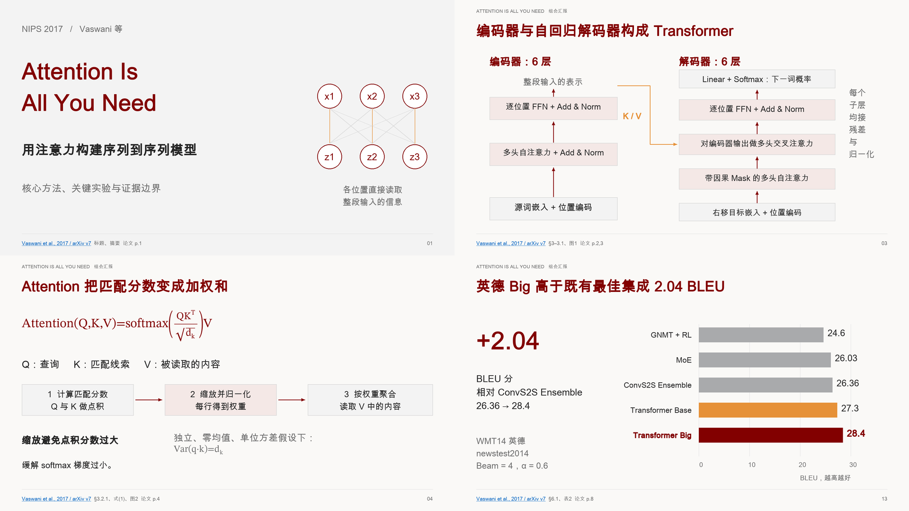
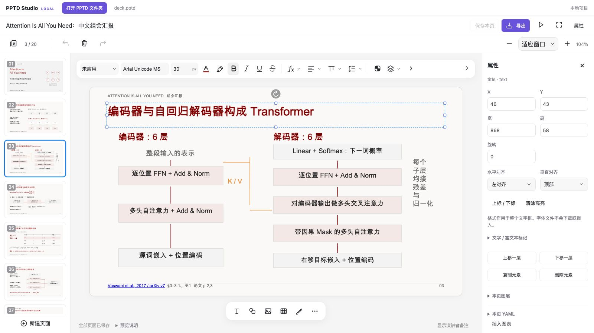

# PPTD Deck Skill

[English](README_EN.md) · [快速开始](#快速开始) · [示例项目](examples/attention-is-all-you-need/README.md) · [使用文档](#文档)

PPTD Deck Skill 是一套面向 AI agent 的 PPT 制作工具。提供主题、文档或论文，agent 会生成可编辑的 PPTD 项目和 PPTX 文件。你可以在配套的网页编辑器中继续修改内容与排版，再导出用于汇报的演示文稿。



《Attention Is All You Need》中文论文导读，选取 4 页布局预览。 [下载 PPTX](examples/attention-is-all-you-need/deck.pptx) · [下载可编辑项目](examples/attention-is-all-you-need/project.zip) · [查看完整示例](examples/attention-is-all-you-need/README.md)

## 快速开始

### 1. 安装 skill

需要 Git、[uv](https://docs.astral.sh/uv/getting-started/installation/) 和 Node.js 18+。uv 会准备 Python 3.12 和项目依赖，无需运行 `npm install`。

macOS / Linux：

```sh
git clone https://github.com/Raven-Beholder/pptd-deck-skill.git
cd pptd-deck-skill
uv sync --locked --python 3.12
uv run --locked node bin/pptd-deck-skill.js install -y --target "$HOME/.codex/skills"
```

<details>
<summary>Windows（PowerShell）</summary>

```powershell
git clone https://github.com/Raven-Beholder/pptd-deck-skill.git
Set-Location pptd-deck-skill
uv sync --locked --python 3.12
uv run --locked node .\bin\pptd-deck-skill.js install -y --target "$env:USERPROFILE\.codex\skills"
```

</details>

<details>
<summary>其他 agent 与安装环境</summary>

通过 `--target` 指定 agent 的 skill 目录，也可以重复指定多个目录。共享目录通常为 `~/.agents/skills`，Claude Code 使用 `~/.claude/skills`。安装后的文件夹名为 `pptd-deck-skill`，重新安装会替换同名 skill。

安装器只复制 skill 文件，运行脚本仍需使用本仓库准备的 Python 环境。请保留仓库与 `.venv`，让 agent 按 `SKILL.md` 中的说明复用该环境。本机安装的 skill 不会自动同步到云端。

`pyproject.toml` 声明依赖，`uv.lock` 锁定版本。下载缓存和 Python 运行时可能保存在用户目录。

</details>

### 2. 让 agent 制作 PPT

让 agent 使用 `pptd-deck-skill`，然后描述需求。比如上传 [Attention Is All You Need](https://arxiv.org/abs/1706.03762v7) 的 PDF，输入：

> 请把这篇论文做成一份适合组会汇报的中文 PPT，讲清核心方法、关键实验和局限，图示尽量直观。

上面的示例由这条提示词生成，共 20 页，包含方法讲解、实验对比和讨论。你也可以指定受众、页数或喜欢的风格。已有主题可以通过 `theme.md` 提供。

完成后会得到 PPTX 和可编辑的项目目录。[完整示例](examples/attention-is-all-you-need/README.md) 中保留了原始提示词、论文来源和全部页面。

## 网页编辑器

网页编辑器在本地运行，可以独立打开 PPTD 项目。选择页面或元素，即可修改文字、公式、图形与排版，保存后继续导出 PPTX。



在仓库目录中打开示例：

```sh
uv run --locked node bin/pptd-deck-skill.js serve examples/attention-is-all-you-need --open
```

创建空白项目：

```sh
uv run --locked node bin/pptd-deck-skill.js serve --open
```

打开其他项目时，在 `serve` 后传入项目目录。请保留服务输出的完整链接，并在停止服务前保存或下载项目。

## 功能

- **可编辑的成品**：保留文字、图形、表格和数学公式，方便继续修改。
- **公式排版**：支持常用 LaTeX 语法，导出为可编辑的 Office Math 对象。
- **主题样式**：统一设置字体、颜色和文字样式，也可以调整单个元素。
- **检查与导出**：检查字体、布局和来源记录，生成默认带淡入转场的 PPTX。

## 文档

- [制作、检查与导出流程](skills/pptd-deck-skill/reference/pipeline.md)
- [PPTD 文件格式](skills/pptd-deck-skill/reference/pptd.md)
- [原生制作支持范围](skills/pptd-deck-skill/reference/native-authoring.md)
- [主题与设计预设](theme.md)
- [Windows 使用说明](skills/pptd-deck-skill/reference/windows.md)

## 开发

在仓库的隔离环境中运行：

```sh
uv run --locked node tools/test_native.mjs
uv run --locked python tools/smoke_native_install.py
uv run --locked python tools/audit_native_tree.py
uv run --locked python tools/build_native_distribution.py --editor --output dist/editor.zip
npm run pack:check
```

CI 覆盖 macOS、Windows 和 Linux。构建使用文件白名单，并记录文件哈希和模块依赖。图标示例见 [预览](docs/native-icons-overview.svg)。

## 当前支持情况

支持 PPTD 制作、编辑和 PPTX 导出。PPTX 导入、字体嵌入和部分复杂特效尚未支持；具体范围见 [原生制作指南](skills/pptd-deck-skill/reference/native-authoring.md)。

布局预览使用 Pillow，公式间距为近似值，不能代替 PowerPoint、WPS 或 Keynote 中的实际渲染检查。Windows 的浏览器拖拽与中文输入法仍需人工检查。

## 许可证

[MIT](LICENSE)。上游版权与第三方依赖见 [告知文件](THIRD_PARTY_NOTICES.md)。

维护者：Raven-Beholder。
